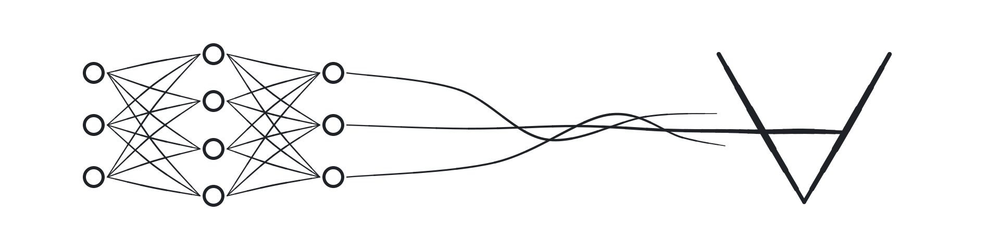

<picture>
	<source media="(prefers-color-scheme: dark)" srcset="assets/banner-dark.png">
	
</picture>

# Awesome Neurosymbolic AI 

∀ · <i>for all</i> · <a href="assets/README.md">the drawing</a> · <a href="assets/banner.desmos.json">its Desmos equations</a> · <a href="scripts/draw_banner.py">the pen</a> · <a href="#contents">contents</a> · <a href="contributing.md">contribute</a>

> Frameworks, reasoners, papers, courses, and benchmarks for neurosymbolic AI — systems that combine neural learning with symbolic reasoning.

Neurosymbolic AI pairs the perception, flexibility, and scale of neural networks with the compositionality, data efficiency, interpretability, and formal guarantees of symbolic methods such as logic programming, constraint solving, theorem proving, and knowledge representation. This list covers both the integration layer (neurosymbolic frameworks proper) and the mature symbolic foundations those systems build on.

Entries are curated: each one is maintained, documented, and useful in practice or foundational in the literature. Read the contribution guidelines (linked at the bottom) before suggesting an addition.

## Contents

- [Rankings](#rankings)
- [Neurosymbolic Frameworks](#neurosymbolic-frameworks)
- [Symbolic Foundations](#symbolic-foundations)
	- [Solvers and Provers](#solvers-and-provers)
	- [Logic Programming](#logic-programming)
	- [Knowledge Representation](#knowledge-representation)
	- [Planning](#planning)
- [LLMs and Symbolic Reasoning](#llms-and-symbolic-reasoning)
- [Papers](#papers)
	- [Surveys](#surveys)
	- [Landmark Papers](#landmark-papers)
- [Books](#books)
- [Courses and Tutorials](#courses-and-tutorials)
- [Benchmarks and Datasets](#benchmarks-and-datasets)
- [Community](#community)
- [Contributing](#contributing)

## Rankings

Generated from the list's own entries and their live metrics: the ten most starred repositories on each side of the neural–symbolic bridge, refreshed weekly.

<!-- rankings -->

## Neurosymbolic Frameworks

Languages and libraries whose core purpose is integrating neural networks with symbolic reasoning.

- [Scallop](https://github.com/scallop-lang/scallop) - Neurosymbolic programming language based on Datalog, with differentiable reasoning built on provenance semirings and tunable reasoning granularity.
- [DeepProbLog](https://github.com/ML-KULeuven/deepproblog) - Neural probabilistic logic programming that extends ProbLog with neural predicates, from KU Leuven.
- [ABLkit](https://github.com/AbductiveLearning/ABLkit) - Toolkit for Abductive Learning, which bridges machine learning and logical abduction, from Nanjing University's LAMDA group.
- [DomiKnowS](https://github.com/HLR/DomiKnowS) - Declarative Python/PyTorch framework for integrating logical domain knowledge as constraints into deep learning, with ILP-based inference.
- [LTNtorch](https://github.com/tommasocarraro/LTNtorch) - PyTorch implementation of Logic Tensor Networks, which ground first-order fuzzy logic into tensor computations for learning with logical constraints.
- [Logic Tensor Networks](https://github.com/logictensornetworks/logictensornetworks) - Original TensorFlow implementation of Logic Tensor Networks (Real Logic).
- [LNN](https://github.com/IBM/LNN) - IBM's Logical Neural Networks, where every neuron represents a component of a weighted real-valued logic formula, supporting omnidirectional inference.
- [NeurASP](https://github.com/azreasoners/NeurASP) - Embraces neural network outputs as probabilistic atom facts in Answer Set Programming.
- [PSL](https://github.com/linqs/psl) - Probabilistic Soft Logic, a mature framework for probabilistic reasoning over relational domains using hinge-loss Markov random fields; basis of the NeuPSL neurosymbolic extension.
- [PyNeuraLogic](https://github.com/LukasZahradnik/PyNeuraLogic) - Differentiable relational logic templates that generalize and extend graph neural networks.
- [PyReason](https://github.com/lab-v2/pyreason) - Explainable reasoning over graphs with open-world annotated logic, supporting temporal reasoning.
- [dPASP](https://github.com/kamel-usp/dpasp) - Differentiable probabilistic answer set programming framework for neurosymbolic inference and learning.

## Symbolic Foundations

Mature, production-grade symbolic engines. These are the reasoning backbones that neurosymbolic systems (and LLM + solver pipelines) call into.

### Solvers and Provers

- [Z3](https://github.com/Z3Prover/z3) - Microsoft Research's SMT solver, the workhorse of program verification, symbolic execution, and constraint solving.
- [cvc5](https://github.com/cvc5/cvc5) - Industrial-strength open-source SMT solver with strong theory support and proof production.
- [Kissat](https://github.com/arminbiere/kissat) - State-of-the-art SAT solver by Armin Biere, a reference implementation in modern CDCL solving.
- [Vampire](https://github.com/vprover/vampire) - Award-winning automated theorem prover for first-order logic.
- [E Prover](https://github.com/eprover/eprover) - High-performance theorem prover for full first-order logic with equality.
- [Lean 4](https://github.com/leanprover/lean4) - Interactive theorem prover and dependently-typed programming language, with the community-maintained [Mathlib](https://github.com/leanprover-community/mathlib4) mathematical library.
- [Isabelle](https://isabelle.in.tum.de) - Generic proof assistant with the large Archive of Formal Proofs ecosystem.
- [Rocq](https://rocq-prover.org) - Interactive theorem prover based on the calculus of inductive constructions, formerly known as Coq.
- [OR-Tools](https://github.com/google/or-tools) - Google's operations research suite, including the award-winning CP-SAT constraint programming solver.
- [MiniZinc](https://www.minizinc.org) - Solver-independent constraint modeling language, the lingua franca of constraint programming.

### Logic Programming

- [SWI-Prolog](https://www.swi-prolog.org) - The most widely used open-source Prolog system, actively maintained for decades.
- [Scryer Prolog](https://github.com/mthom/scryer-prolog) - Modern ISO-conforming Prolog implemented in Rust.
- [Clingo](https://github.com/potassco/clingo) - The standard Answer Set Programming system from the Potassco project.
- [ProbLog](https://github.com/ML-KULeuven/problog) - Probabilistic logic programming language and engine, the symbolic substrate of DeepProbLog.
- [Soufflé](https://github.com/souffle-lang/souffle) - High-performance Datalog engine that compiles to parallel C++, used in static analysis at scale.
- [miniKanren](https://minikanren.org) - Family of embeddable relational programming languages with implementations in dozens of host languages.

### Knowledge Representation

- [Protégé](https://github.com/protegeproject/protege) - The standard open-source ontology editor for OWL, from Stanford.
- [ELK](https://github.com/liveontologies/elk-reasoner) - Very fast OWL EL reasoner used with large biomedical ontologies such as SNOMED CT.
- [Apache Jena](https://jena.apache.org) - Java framework for building Semantic Web and linked data applications with RDF, SPARQL, and OWL.
- [RDFLib](https://github.com/RDFLib/rdflib) - Pure-Python library for working with RDF, SPARQL, and serialization formats.
- [OWL API](https://github.com/owlcs/owlapi) - Reference Java API for creating and manipulating OWL ontologies.
- [mOWL](https://github.com/bio-ontology-research-group/mowl) - Python library for machine learning with ontologies, embedding OWL knowledge into vector spaces.

### Planning

- [Fast Downward](https://github.com/aibasel/downward) - The reference classical planning system built on heuristic search.
- [Unified Planning](https://github.com/aiplan4eu/unified-planning) - Python API providing a single interface to many planning engines, from the AIPlan4EU project.
- [Planning.wiki](https://planning.wiki) - Community guide to PDDL and automated planning tools.

## LLMs and Symbolic Reasoning

Where most practical adoption is happening today: pairing large language models with symbolic engines that check, constrain, or execute their outputs.

- [SynaLinks](https://github.com/SynaLinks/synalinks) - Keras-inspired framework for building neurosymbolic language-model applications with knowledge graphs and constrained structured output.
- [SymbolicAI](https://github.com/ExtensityAI/symbolicai) - Compositional differentiable programming library that treats LLMs as semantic parsers embedded in a symbolic framework.
- [LeanDojo](https://github.com/lean-dojo/LeanDojo) - Open toolkit for interacting with Lean, including retrieval-augmented LLM-based theorem proving.
- [AlphaGeometry](https://github.com/google-deepmind/alphageometry) - DeepMind's neurosymbolic system combining a language model with a symbolic deduction engine, reaching olympiad-level geometry.
- [Outlines](https://github.com/dottxt-ai/outlines) - Constrained text generation that guarantees LLM outputs conform to regular expressions, grammars, or JSON schemas via finite-state machines.
- [Guidance](https://github.com/guidance-ai/guidance) - Programming paradigm for steering LLMs with grammars, regular expressions, and control flow, with guaranteed output structure.
- [Nucleoid](https://github.com/NucleoidAI/Nucleoid) - Declarative logic runtime that accumulates statements into an adaptive logic graph, positioned as neurosymbolic infrastructure for world models.

## Papers

> [!TIP]
> **📌 Curated pick:** [Neuro-Symbolic Frameworks: Conceptual Characterization and Empirical Comparative Analysis](https://neurosymbolic-ai-journal.com/system/files/nai-paper-924_0.pdf) (Sinha, Premsri, Kamali and Kordjamshidi — Neurosymbolic Artificial Intelligence journal, 2026).
> A conceptual characterization and head-to-head empirical comparison of NeSy frameworks, including DomiKnowS, DeepProbLog, and Scallop — the best single read before choosing a framework from this list.

### Surveys

- [Neurosymbolic AI: The 3rd Wave](https://arxiv.org/abs/2012.05876) - Garcez and Lamb's influential position paper framing the modern neurosymbolic agenda (2020).
- [The Next Decade in AI: Four Steps Towards Robust Artificial Intelligence](https://arxiv.org/abs/2002.06177) - Gary Marcus's hybrid-AI manifesto: robust AI needs hybrid neurosymbolic architectures, large-scale knowledge, explicit reasoning, and cognitive models (2020).
- [Neurosymbolic AI — Why, What, and How](https://arxiv.org/abs/2305.00813) - Concise introduction by Sheth, Roy, and Gaur (2023).
- [From Statistical Relational to Neurosymbolic Artificial Intelligence: A Survey](https://arxiv.org/abs/2108.11451) - Marra et al. connect neurosymbolic AI to its statistical relational learning roots (2021).
- [Neuro-Symbolic AI and Its Taxonomy: A Survey](https://arxiv.org/abs/2305.08876) - Systematic taxonomy of integration patterns (2023).
- [Survey on Applications of Neurosymbolic Artificial Intelligence](https://arxiv.org/abs/2209.12618) - Application-focused view of the field (2022).
- [Neurosymbolic AI for Reasoning Over Knowledge Graphs: A Survey](https://doi.org/10.1109/TNNLS.2024.3420218) - DeLong, Mir, and Fleuriot's IEEE TNNLS survey of neurosymbolic reasoning on graphs (2024).
- [Neurosymbolic Programming](https://www.nowpublishers.com/article/Details/PGL-049) - Chaudhuri et al.'s Foundations and Trends monograph treating neurosymbolic systems as a programming languages problem (2021).

### Landmark Papers

- [Harnessing Deep Neural Networks with Logic Rules](https://arxiv.org/abs/1603.06318) - Hu et al. distill logic rules into network weights via posterior regularization (2016).
- [End-to-End Differentiable Proving](https://arxiv.org/abs/1705.11040) - Rocktäschel and Riedel's Neural Theorem Provers over knowledge bases (2017).
- [A Semantic Loss Function for Deep Learning with Symbolic Knowledge](https://arxiv.org/abs/1711.11157) - Xu et al. turn logical constraints into a differentiable loss via knowledge compilation (2018).
- [DeepProbLog: Neural Probabilistic Logic Programming](https://arxiv.org/abs/1805.10872) - Manhaeve et al. introduce neural predicates in probabilistic logic programs (2018).
- [The Neuro-Symbolic Concept Learner](https://arxiv.org/abs/1904.12584) - Mao et al. learn visual concepts, words, and semantic parsing without explicit supervision (2019).
- [SATNet: Bridging Deep Learning and Logical Reasoning](https://arxiv.org/abs/1905.12149) - Wang et al. embed a differentiable MAXSAT solver in neural networks (2019).
- [Logic-LM: Empowering Large Language Models with Symbolic Solvers](https://arxiv.org/abs/2305.12295) - Pan et al. parse problems with an LLM and offload the reasoning to Prolog, Z3, and Pyke (2023).

## Books

- [Neuro-Symbolic Artificial Intelligence: The State of the Art](https://ebooks.iospress.nl/volume/neuro-symbolic-artificial-intelligence-the-state-of-the-art) - Edited volume by Hitzler and Sarker surveying the field's main threads (IOS Press, 2021).
- [Compendium of Neurosymbolic Artificial Intelligence](https://ebooks.iospress.nl/volume/compendium-of-neurosymbolic-artificial-intelligence) - Follow-up edited volume collecting extended versions of recent key papers (IOS Press, 2023).

## Courses and Tutorials

- [Summer School on Neurosymbolic Programming](https://www.neurosymbolic.org) - Annual summer school with recorded lectures from leading researchers.
- [IBM Neuro-Symbolic AI Toolkit](https://ibm.github.io/neuro-symbolic-ai) - Entry point to IBM's neurosymbolic projects, papers, and demos.

## Benchmarks and Datasets

- [CLEVR](https://github.com/facebookresearch/clevr-dataset-gen) - Diagnostic dataset for compositional visual reasoning, the classic testbed for neurosymbolic VQA.
- [FOLIO](https://github.com/Yale-LILY/FOLIO) - First-order logic reasoning benchmark with natural language annotated by logicians.
- [ProofWriter](https://allenai.org/data/proofwriter) - Datasets of entailment trees for rule-based reasoning over natural language from AI2.
- [ARC-AGI](https://github.com/fchollet/ARC-AGI) - Chollet's Abstraction and Reasoning Corpus, a benchmark of core-knowledge program induction tasks.
- [rsbench](https://unitn-sml.github.io/rsbench) - Suite for systematically evaluating reasoning shortcuts in neurosymbolic models.

## Community

- [Neurosymbolic Artificial Intelligence Journal](https://neurosymbolic-ai-journal.com) - Open-access journal dedicated to the field, with an open and transparent review process.
- [Neural-Symbolic Learning and Reasoning Association](https://neural-symbolic.org) - Home of the long-running NeSy conference series, held since 2005.

## Related Lists

- [Awesome LLM Reasoning with NeSy](https://github.com/LAMDA-NeSy/Awesome-LLM-Reasoning-with-NeSy) - Paper-centric list on neurosymbolic learning in the LLM era, from the LAMDA NeSy group.
- [Awesome Neurosymbolic AI (benchmarks)](https://github.com/sciknoworg/awesome-neurosymbolic-ai) - Catalog of benchmarks, datasets, and evaluation resources.
- [Awesome Neurosymbolic Computer Vision](https://github.com/marcionicolau/awesome-neurosymbolic-cv) - Companion list to a neurosymbolic computer vision survey.
- [NeSymGraphs](https://github.com/NeSymGraphs) - GitHub organization collecting implementations from a survey on neurosymbolic reasoning over knowledge graphs.

## Contributing

Contributions are welcome! Please read the [contribution guidelines](contributing.md) first, then open a pull request. One entry per pull request keeps reviews fast.
